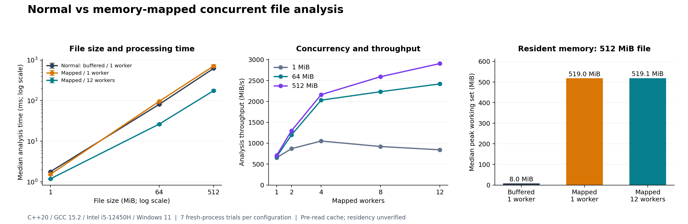

# Measured comparison

Measured on 6 October 2026 (Asia/Kolkata) using the implemented C++20 Release application. The core analyzer, generator, benchmark runner, and CSV/Markdown exports are all C++.



## Normal versus the selected method

The selected method is read-only memory mapping with 12 workers. This table uses the same worker count at every file size, rather than selecting a different best configuration for each row.

| Seeded log size | Normal buffered, 1 worker | Mapped, 1 worker | Mapped concurrent, 12 workers | Speedup vs normal |
| --- | --- | --- | --- | --- |
| 1 MiB | 1.783 ms | 1.535 ms | 1.186 ms | 1.50x |
| 64 MiB | 81.115 ms | 96.250 ms | 26.460 ms | 3.07x |
| 512 MiB | 622.653 ms | 714.743 ms | 176.214 ms | 3.53x |

Every entry is a median of seven timed runs. Each configuration ran in a fresh process, with its order shuffled within each round. The parent completely pre-read the file before each trial. Timing includes opening, mapping/allocation, partitioning, worker creation/joining, scanning, reduction, and cleanup; process startup and report output are excluded.

There are 147 timed observations: three file sizes, seven configurations, and seven runs. Every timed analysis matched all counts from the buffered reference. The exported medians and interquartile ranges were independently recalculated from the raw CSV observations and verified.

## What the experiment shows

- For this log workload, concurrency provides the improvement. Single-threaded mapping was slower than buffered reading on 64 and 512 MiB files.
- On the 512 MiB file, mapped concurrent analysis achieved about 2,906 MiB/s of analysis throughput and reduced elapsed time by 71.7% relative to buffered reading.
- More workers have diminishing benefits. On the 1 MiB file, four workers were faster than twelve; thread startup and other fixed costs matter at that size.
- Mapping uses more resident memory in this experiment. On the 512 MiB file, median lifetime peak working set was 8.02 MiB for buffered reading, 518.99 MiB for single-threaded mapping, and 519.09 MiB for twelve-worker mapped analysis. Resident mapped pages are included; these values do not measure the machine's entire filesystem cache or total physical-memory cost across processes.
- CPU time and elapsed time differ. At 512 MiB, twelve-worker analysis used a median 1.344 seconds of process CPU time across its threads, versus 0.625 seconds for buffered reading, despite finishing sooner in wall time.

These are pre-read cache measurements with unverified residency, not cold-cache tests or raw disk-speed measurements. The results support this implementation on this dataset and machine; mapping or multithreading is not guaranteed to be faster on every workload. Source and executable directories remained in this workspace, while datasets were stored outside OneDrive under `%LOCALAPPDATA%\FileAnalyzer\OS_project_2026\datasets`.

Published reports identify inputs by dataset-relative names. Machine-specific absolute input paths were removed before publication; the measured counts, timings, and environment statistics are unchanged.

## Machine and validation

- Processor: 12th Gen Intel Core i5-12450H; 12 logical processors.
- OS: Windows 11 Home Single Language, build 26300.
- RAM: about 15.65 GiB visible to Windows.
- Local storage model reported by Windows: SAMSUNG MZVL4512HBLU-00BH1; NTFS volume.
- Compiler: MinGW GCC 15.2.0; C++20, `-O3`, `NDEBUG`, static C++/threading runtime.
- Buffered read size: 1 MiB.
- Generator seed: 42; deterministic exact-size files. Trial-order seed: 42.
- Correctness: 6,634 core checks plus 22 CLI/subprocess checks passed. These include an independent reference, token/read boundaries, LF/CRLF, oversized lines, randomized text, Unicode paths, empty-file trials, invalid arguments, and input protection.
- The GCC PowerShell build was verified locally. The supplied CMake configuration is available for other Windows toolchains; CMake was not installed on this machine during this run.

## Detailed observations

- [1 MiB comparison](benchmark-1mib.md), [raw trials](benchmark-1mib.csv), [summary](benchmark-1mib.summary.csv).
- [64 MiB comparison](benchmark-64mib.md), [raw trials](benchmark-64mib.csv), [summary](benchmark-64mib.summary.csv).
- [512 MiB comparison](benchmark-512mib.md), [raw trials](benchmark-512mib.csv), [summary](benchmark-512mib.summary.csv).
- [Vector version of the charts](comparison.svg).

The graph's time error bars show the 25th to 75th percentiles. The worker graph shows mapped analysis throughput at 1, 2, 4, 8, and 12 workers. The memory graph shows the 512 MiB dataset.

## Reproduce

From the project folder:

```powershell
.\scripts\build.ps1 -RunTests
.\scripts\demo.ps1 -SizeMiB 512 -Runs 7 -Threads '1,2,4,8,12'
```

The demo reuses an existing dataset at the documented seed-based path; remove or rename a modified dataset, or deliberately regenerate it with the generator's `--force` flag before collecting a new comparison. A new demo run replaces that size's CSV and Markdown reports; the combined chart and this narrative are snapshots of the measurements above.
